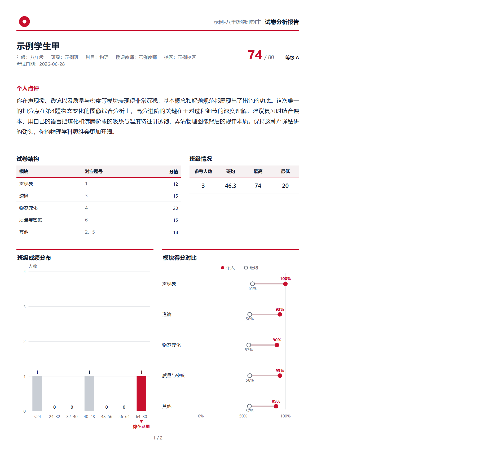
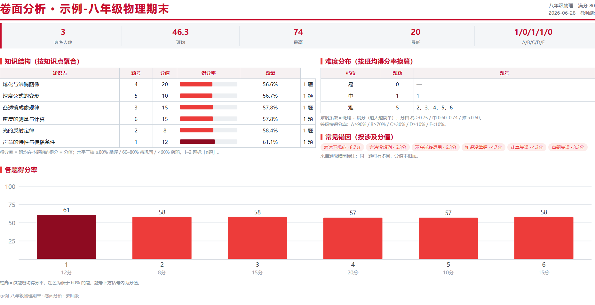

# 试卷分析报告 · exam-analysis-report

> 一位老师、一次考试、一份 Excel：给**每个学生**出一份两页 A4 分析报告，外加一页班级卷面分析。
> 收表校验 → 逐人点评 → 排版打印 → 14 项自动质检，全程离线、零第三方依赖。

*An offline skill package that turns one exam-paper spreadsheet into per-student PDF analysis reports (2-page A4 each) plus a one-page class panel. Python 3.9+ standard library only; PDFs are printed by headless Edge/Chrome. No server, no network, no data leaves the machine.*




> 上面两张图由仓库自带的 `demo/`（3 个虚构学生、6 道题）一键跑出，不含任何真实数据；
> 示例校徽由脚本现场生成，主题色是从这枚校徽里自动取出的。

---

## 它解决什么

老师手里一般是「一份卷子 + 一张分数表」，把它变成能发给家长的东西要费很多手工：
逐题统计、算班均、写点评、排版、核页数、防止数字说错。

这个 skill 把这条链路固化成脚本 + 一份写作规范：

| 步骤 | 谁做 | 产出 |
|---|---|---|
| ① 收表（表头识别、逐格校验、原卷归档） | 脚本 | `paper.json`、`录分结果.json` |
| ② 统计、证据包、报告骨架 | 脚本 | `reports/点评证据包.json`（含数字白名单） |
| ③ 写逐人点评（一段话，120–180 字） | AI | `panels.json` |
| ④ 排版、画图、分页、打 PDF、打包 | 脚本 | `reports/*.pdf`、`全部报告.zip` |
| ⑤ 14 项质检（分值/页数/字数/禁用词/数字来源…） | 脚本 | 全绿才算交付 |

关键设计取舍：

- **点评只有一段**，印在第一页最显眼处，面向学生本人和身旁的家长；不写排名、不横向拉踩。
- **证据包是唯一事实来源**：点评里出现的成绩数字必须在白名单里，`verify.py` 逐条拦。
- **口径可配不可改**：等级阈值（A≥90% / B≥70% / C≥30% / D≥10%）写在 `paper.json`，换学校口径改配置，不动脚本。
- **换机构只换 Logo 和颜色**：主题色从 Logo 自动取主色（按印刷对比度压深），也可 `--theme "#C8102E"` 指定；本包不含任何机构标识。
- **零依赖**：Excel 读写走自带的 `xlsxlite.py`，不装 openpyxl / pandas；HTML 用 `@@TOKEN@@` 替换，不装 jinja2。

## 安装

包内 `exam-analysis-report/` 就是一个完整 skill 目录，`SKILL.md` 是给 AI 的执行说明，`README.md` 是给人看的使用手册。

**方式一：上传 zip（WorkBuddy 等支持 skill 包的环境）**

从本仓库的 Releases 下载 `exam-analysis-report-vX.Y.Z.zip`（或自行 `zip` 打包 `exam-analysis-report/`），
在技能面板「添加技能 → 上传技能」选它，确认弹窗，然后**重开一个对话**（技能列表在会话启动时加载）。

**方式二：放进技能目录**

```bash
git clone https://github.com/nyxessa/exam-analysis-report.git
cp -r exam-analysis-report/exam-analysis-report ~/.workbuddy/skills/exam-analysis-report
```

确认路径是 `.../skills/exam-analysis-report/SKILL.md`（不要把 `SKILL.md` 直接摊在 `skills/` 下）。
Windows 的技能目录是 `%USERPROFILE%\.workbuddy\skills\`。

**方式三：不带技能框架直接跑**

所有脚本都是普通 Python 命令行，可以当工具用：

```bash
cd exam-analysis-report
python scripts/ingest_excel.py --xlsx "老师给的表.xlsx" --out "期末-八年级物理"
python scripts/build_reports.py --exam-dir "期末-八年级物理" --no-pdf   # 出骨架和证据包
# 写 panels.json（规范见 references/comment-prompt.md）
python scripts/build_reports.py --exam-dir "期末-八年级物理"
python scripts/verify.py --exam-dir "期末-八年级物理"
```

## 装完先自验

```bash
python scripts/selftest.py      # 环境自检：依赖、素材、Excel 读写闭环、浏览器
python scripts/demo.py          # 3 个虚构学生跑通全链路，能出 4 份 PDF 就是装好了
```

`demo.py` 只读仓库自带的示例数据，输出到系统临时目录，跑完打印路径。
真数据上场前这两条必须都过；出不来先看 `references/troubleshooting.md`。

## 输入模板

`exam-analysis-report/assets/试卷分析模板.xlsx`，两个 Sheet：

- **试卷信息**：考试名称 / 日期 / 校区 / 年级 / 班级 / 科目 / 授课教师 / 卷面满分 / 备注，加逐题 10 列（题号、题型、分值、对应模块、知识点、常见错因、复习页码、复习题号、后续建议、题目备注）；
- **学生成绩**：学号、姓名、缺考、第 1…N 题、学生备注。

题多或人多时重新生成：`python scripts/make_template.py --questions 30 --students 80`。

收表会拦下并指到单元格：题号重复、分值和≠卷面满分、得分超满分、学号重复、分值非数字、缺题号。

## 输出

```
考试文件夹/
├── paper.json              考试信息 + 题目结构
├── 录分结果.json            学生逐题得分
├── panels.json             逐人点评（AI 写）
├── reports/
│   ├── 点评证据包.json       写点评的唯一事实来源
│   ├── 001_姓名.pdf/.html  每人 1–3 页
│   ├── 卷面分析.pdf         教师版一页
│   ├── 渲染信息.json        每份应有几页（质检拿它核）
│   └── 全部报告.zip
└── 台账.csv
```

## 环境

| 项 | 要求 |
|---|---|
| Python | 3.9+，只用标准库，不需要 pip |
| 浏览器 | Microsoft Edge 或 Chrome（无头打印 PDF），可用 `EDGE_PATH` 指定 |
| 网络 | 不需要，全程离线 |

## 目录

```
.
├── exam-analysis-report/       skill 包本体（= 装进 skills/ 的那个目录）
│   ├── SKILL.md                给 AI 的执行说明
│   ├── README.md               给老师看的使用手册
│   ├── LICENSE.md              许可全文
│   ├── assets/                 模板、两套 HTML 版式、错因字典
│   ├── scripts/                收表 / 统计 / 排版 / 质检 / xlsx 读写
│   ├── references/             点评规范、字段说明、教师说明、排障
│   └── demo/                   3 个虚构学生的示例数据
├── docs/                       README 截图
└── LICENSE.md
```

## 隐私

仓库里没有真实师生姓名、没有真实班级或机构标识、没有真实考试数据。
`demo/` 的三名学生（示例学生甲/乙/丙）与示例校徽全部虚构。

使用时所有数据都留在本机：脚本不联网、不上传、不写日志到外部服务；
生成的 `reports/` 与 `台账.csv` 建议加入使用者自己的 `.gitignore`。

## 许可

[PolyForm Noncommercial 1.0.0](LICENSE.md) + **教育使用补充授权**：

- **可以**：教师在个人教学、学校教学、教培活动中免费使用（含批量出报告）；为教学目的修改、研究和分享；
- **需要另行授权**：集成进闭源商业软件、做成收费 SaaS / 商业 API / 商业智能体服务，或用托管、插件封装绕开限制；
- 再分发时请随包保留 `LICENSE.md`。

## 版本

当前 **v2.4.1**。完整变更表见 [`exam-analysis-report/README.md`](exam-analysis-report/README.md#版本)。
